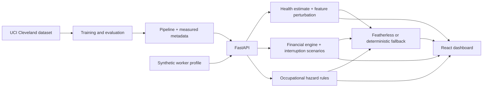

# SehatRozgar

**Health + Financial Resilience Intelligence for Workers**

Track 02 — Applied: Medical Technology & Finance

## Problem

For daily-wage workers, illness can mean both a medical expense and lost income. Health and financial planning tools usually show these consequences separately.

## Insight

When a worker gets sick, the cost is not only healthcare. Their income may stop too.

## Solution

SehatRozgar combines a public-data health-risk model, a deterministic income-interruption and financial-vulnerability engine, occupation-based hazard references, and plain-language explanations. The dashboard keeps these dimensions distinct so a model probability is never presented as a diagnosis or used to calculate financial vulnerability.

## How it works

1. Select one of six clearly labeled fictional worker profiles or edit a profile in Assessment.
2. The FastAPI backend runs a model trained on the UCI Heart Disease processed Cleveland subset.
3. Deterministic formulas calculate income loss, event exposure, savings runway, emergency-fund gap, and a 0-100 informational vulnerability index.
4. A rules-based occupation map lists common hazards; it does not predict injuries.
5. The optional Featherless layer explains those outputs. Without configuration or on failure, deterministic guidance remains available.

## Architecture



## Dataset

UCI Machine Learning Repository, [Heart Disease](https://archive.ics.uci.edu/dataset/45/heart+disease), processed Cleveland subset. The training script validates 303 empirical rows, uses 13 source features, maps the source target `num` to 0 versus 1-4, and imputes missing values within a stratified train/test pipeline. It does not create synthetic training records.

## Machine learning

The reproducible trainer compares Logistic Regression, Random Forest, and Gradient Boosting using a fixed stratified 75/25 holdout split (seed 42). The selected model is the one with the highest holdout ROC-AUC. Metrics on the Model Performance page are read from `backend/app/ml/model_metadata.json` generated by training. The small historic cohort and single split are not evidence of clinical validity or worker-population performance.

## Explainable AI

The current feature contribution view uses one-feature-at-a-time perturbation to the training-set imputation baseline. Contributions describe model behavior, not medical causation. SHAP is not currently included.

## Financial resilience engine

Income interruption and exposure are deterministic. The Financial Vulnerability Index weights savings runway (25%), expense-to-income (20%), emergency-fund gap (20%), dependents (10%), event coverage (15%), and interruption exposure (10%). It does not include the health-model probability. Formula details are available in Methodology.

## Occupational hazard engine

Occupation mappings are configuration data in `backend/app/datasets/occupational_hazards.json`. Results are informational hazard references and do not predict workplace injury.

## Featherless AI

Set `FEATHERLESS_API_KEY`, `FEATHERLESS_BASE_URL`, and `FEATHERLESS_MODEL` to enable the optional OpenAI-compatible chat-completions endpoint. Names and identifiers are removed before requests. The LLM explains supplied structured outputs; it does not predict health, calculate metrics, change scores, or make eligibility decisions. The local deterministic fallback works without credentials.

## Installation

Requirements: Python 3.11+, Node.js 20+, and internet access for first-time dependency/dataset download. No Docker or database is required for the demo.

### Backend (Windows PowerShell)

```powershell
cd backend
python -m venv .venv
.\.venv\Scripts\Activate.ps1
python -m pip install -r requirements.txt
python scripts/download_dataset.py
python -m app.ml.train
python -m uvicorn app.main:app --reload --host 127.0.0.1 --port 8000
```

The API runs at `http://127.0.0.1:8000`; interactive API docs are at `/docs`.

### Frontend (second terminal)

```powershell
cd frontend
npm install
npm run dev
```

Open `http://127.0.0.1:5173`. Set `VITE_API_URL` only if the backend URL differs from `http://127.0.0.1:8000/api`.

### Model training

From `backend/`: `python -m app.ml.train`. This writes the local model artifact and measured metadata. Re-run after changing the training data or pipeline.

## Environment variables

Copy `.env.example` to `.env` and set Featherless values only when testing the optional provider. The API does not currently require `DATABASE_URL`; assessments are not persisted.

## Testing

From `backend/`: `python -m pytest -q`. From `frontend/`: `npm run build`.

## Demo

**Demo presentation:** [Watch the SehatRozgar demo](https://youtu.be/T81c4e-24js)

The landing page opens with Ahmed's API-backed synthetic snapshot. Select **Run 60-second demo** to open the dashboard, adjust the days-off slider, switch synthetic profiles, or edit inputs in Assessment. No real patient information is needed.

## Ethics & safety

- Health results are statistical research indicators, not diagnosis or medical advice.
- Financial vulnerability is informational and must not be used for lending, insurance pricing, employment, or eligibility decisions.
- Feature contributions are not causal explanations.
- Analytics use synthetic profiles only and do not expose individual medical details.
- No real money, real patients, or credentials are included.

## Limitations

The health dataset is small, historical, and not worker-specific. The UI accepts source dataset codes, the holdout is a single split, and neither calibration nor external validation is implemented. Household scenarios are simplified, the hazard map is rules-based, and data is not persisted. Featherless behavior requires user-provided credentials and network access; the fallback is always available.

## Future work

External validation on suitable public worker-relevant cohorts, calibration and subgroup evaluation, validated local-language review, richer explainability, and optional local persistence with explicit privacy controls.