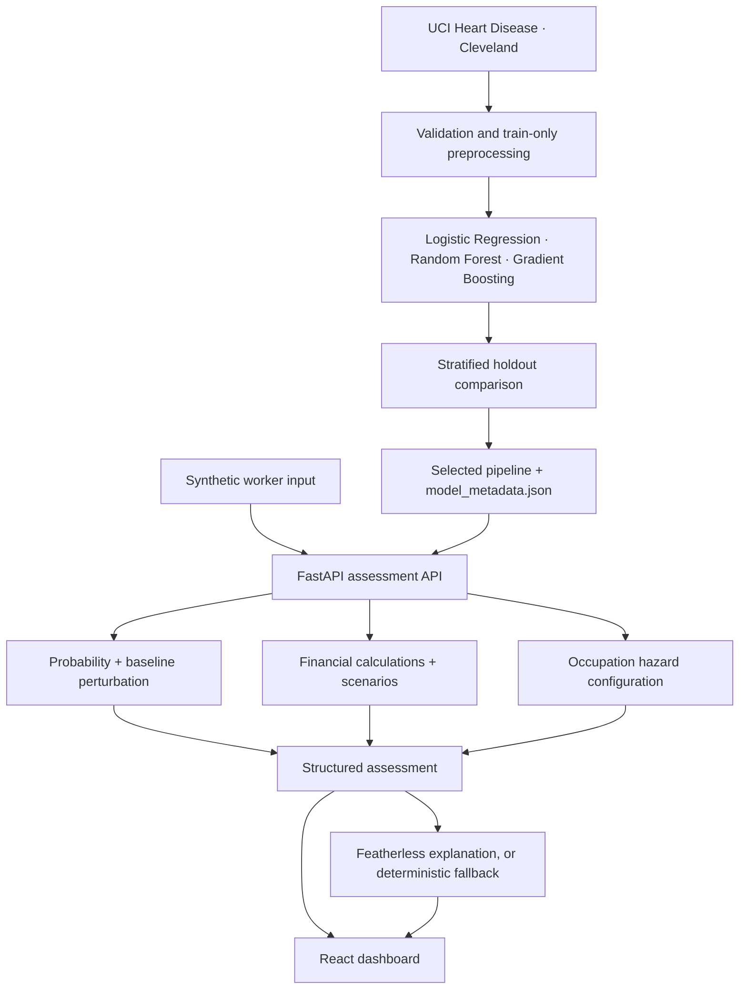

# Architecture

SehatRozgar is a local two-process prototype: a React/Vite client and one FastAPI service. There are no microservices, database requirements, or real-worker records.

## Components

- `backend/app/ml/train.py` validates the downloaded empirical data, fits preprocessing inside each training pipeline, compares three classifiers, and writes the selected joblib artifact and actual holdout metrics.
- `backend/app/ml/predictor.py` loads only a trained artifact, scores source-compatible features, and computes feature perturbation contributions.
- `backend/app/services/financial.py` owns all financial formulas, safe division, scenario calculations, and the transparent index.
- `backend/app/services/occupational.py` reads occupation mappings from JSON. It does not make injury predictions.
- `backend/app/services/ai/` sanitizes structured inputs, optionally calls Featherless, validates JSON with Pydantic, and falls back deterministically.
- `backend/app/main.py` exposes the API used by the React dashboard.
- `frontend/src/` renders worker assessments, interactive scenarios, synthetic-only workforce aggregates, model metrics, and methodology.

## API

`GET /api/health`, `GET /api/demo/workers`, `GET /api/demo/workers/{id}`, `POST /api/assessment`, `POST /api/financial/simulate`, `POST /api/ai/explain`, `GET /api/model`, `GET /api/model/metrics`, `GET /api/methodology`, and `GET /api/workforce/analytics`.

Assessments are in-memory request/response operations and are not stored.